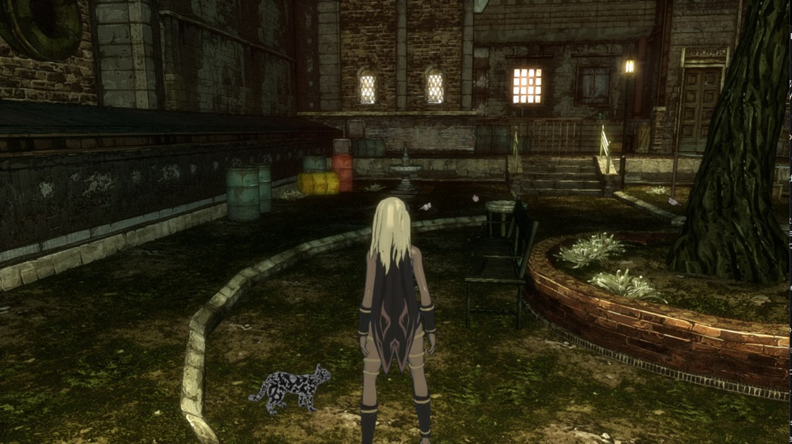
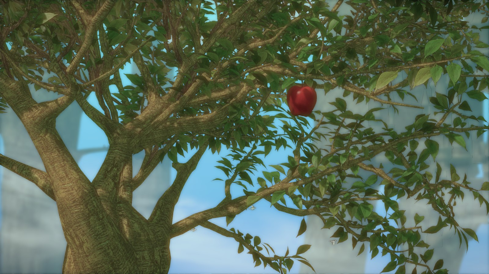

<h1 align="center">gr-port</h1>

<p align="center">
  <b>Gravity Rush Remastered running natively on Windows</b><br>
  A from-scratch translation layer for the PS4 version (CUSA01113): the original game code runs
  directly on your CPU, the PS4 system libraries are reimplemented, and the GPU work is translated to Vulkan.
</p>

<p align="center">
  
</p>

> **Status: early but playable in parts.** The game boots, shows the title menu, plays the opening
> with the falling apple, the comic dialogues, and reaches gameplay in Hekseville with Kat, the cat
> and the pigeons on screen. Pre-rendered movies play (Media Foundation); audio is not implemented yet.

---

## What this is

`gr-port` is **not** an emulator for the whole PS4, and it is not a source port either: nobody has the
source code. It is a dedicated compatibility layer for one game, in the spirit of Wine:

| PS4 piece | What gr-port does |
|---|---|
| Game code (x86-64, AMD Jaguar) | Loaded as is and executed **natively**: same architecture, no CPU emulation |
| System libraries (`libkernel`, `libSceGnmDriver`, VideoOut, Pad, SaveData, Fios, fonts, …) | Reimplemented on top of Win32 (HLE); the game's own modules (`libc`, `libSceFios2`) run unmodified |
| GPU command buffers (PM4) | Parsed on a host "GPU thread" |
| GCN shaders (vertex, pixel, compute, export/geometry) | Recompiled on the fly: GCN → GLSL → SPIR-V (glslang) |
| Rendering | Vulkan 1.3 (dynamic rendering), with render-target tracking, detiling and HTILE fast clears |

It contains **no game code or assets**. You need your own legally obtained copy, extracted from
the PKG; gr-port reads it without modifying it.

<p align="center">
  
</p>

## Highlights

- **Native execution** of the eboot with SysV ↔ Microsoft x64 thunks, TLS rewriting, an Orbis-like
  memory layout and a guest crash handler with backtraces.
- **GCN shader recompiler**: one Vulkan invocation per GCN lane, scalar pre-execution on the host,
  control flow through a dispatcher, LDS, wave64 subgroups, image and buffer stores, swizzled ring
  buffers.
- **The legacy geometry pipeline** (ES → GS → copy VS) emulated with compute passes: Gravity Rush
  draws its characters with it, which is why Kat was invisible for a long time.
- **Render targets that the CPU reads** (e.g. the 1x1 luminance target that drives auto-exposure)
  are written back to guest memory.
- **Debugging tools built for reverse engineering**: draw traces with per-draw occlusion queries,
  RenderDoc captures, int3 hit counters and register capture on guest code, memory watchpoints,
  shader dumps, a GCN disassembler and headless Ghidra scripts.

## Requirements

- Windows 10/11 x64
- A GPU with a Vulkan 1.3 driver (dynamic rendering and synchronization2)
- Visual Studio 2022 Build Tools (MSVC, CMake and Ninja)
- Git (the first configure downloads Vulkan-Headers, Capstone, stb and glslang). The Vulkan SDK is
  **not** required.

## Build

From an *x64 Native Tools Command Prompt for VS 2022* (or after running `vcvars64.bat`):

```bat
cmake -S . -B build -G Ninja -DCMAKE_BUILD_TYPE=Release
cmake --build build
```

The executables end up in `build\bin\`.

## Preparing the game

Extract your PKG with the **.NET Framework** build of PkgTool (LibOrbisPkg 0.2.231):

```bat
PkgTool.exe pkg_extract Gravity_Rush_Remastered.pkg CUSA01113_v2
```

Do not use `PkgTool.Core` on .NET 6 or later: it writes `.psarc` archives with zeroed blocks. To
check an extraction, `build\bin\psarc_tool stats <archive>` must show readable file names.

## Running

```bat
build\bin\gr_port.exe <path>\CUSA01113_v2\uroot --run
```

| Key | Pad |
|---|---|
| WASD | left stick |
| IJKL | right stick |
| Arrows | d-pad |
| Space / Backspace / F / R | Cross / Circle / Square / Triangle |
| Q / E, Z / C | L1 / R1, L2 / R2 |
| Enter / Tab | Options / touchpad |
| Esc | quit |

Any XInput controller works too. Saves go to `build\bin\savedata\`. Gravity Rush only shows the
title menu once a save exists; on the first boot it goes straight to a new game.

If the monitor is connected to a different GPU than the one used for rendering (integrated +
discrete), the window gets its own Vulkan device on the monitor's GPU and frames are copied over.

## Project layout

```
common/         inflate, SHA-1, PSARC, SELF → ELF, Orbis ELF parser, NIDs, GCN decoder
loader/         linker, HLE + ABI thunks, TLS, guest memory and threads, crash handler, trace, window
loader/kernel/  libkernel and services: memory, threads, sync, files/VFS, pad, audio, fibers, fonts, AvPlayer, SaveData
loader/gpu/     GPU thread (PM4), GNM driver, VideoOut, capture, GCN → SPIR-V recompiler, Vulkan renderer, RenderDoc hook
tools/          psarc_tool, self2elf, nid_inventory, gr_disasm, gcn_dis, Ghidra scripts
data/           known Orbis symbol names (NID database)
docs/           PLAN.md (analysis, roadmap, findings), DEBUGGING.md (options, env vars, tools)
external/       third-party headers (RenderDoc in-app API, MIT)
```

## Roadmap

1. **Make the game fully playable**: remaining rendering issues (some materials, 2D macro-tiled
   textures, performance), audio (NGS2 / SXD banks → WASAPI, movie sound).
2. **Mod support**: a `mods/` folder that overrides archive files, editable Lua scripts (most of the
   mission and event logic is plain Lua), code patches, texture and shader replacement, higher
   resolutions and frame rates.
3. **Reverse engineering, as a challenge**: map the eboot, rewrite selected functions in C++ and
   grow the rewritten part subsystem by subsystem, to see how close to a real port we can get.

The full plan, with every finding along the way, is in [docs/PLAN.md](docs/PLAN.md).
Development options and tools are described in [docs/DEBUGGING.md](docs/DEBUGGING.md); testing
shortcuts (skip the prologue, start at any mission, scripted scenarios with frame comparison) and the
rules they follow are in [docs/MODDING_AND_TESTING.md](docs/MODDING_AND_TESTING.md). By default gr-port
always runs the game exactly as shipped.

## Acknowledgements

- [shadPS4](https://github.com/shadps4-emu/shadPS4): an invaluable reference for GCN and GNM details
  (descriptor layouts, tiling, the constant engine, the GNM driver).
- [GR2fork](https://github.com/junminlee2004/GR2fork): the shadPS4 fork for Gravity Rush 2.
- [glslang](https://github.com/KhronosGroup/glslang), [Capstone](https://github.com/capstone-engine/capstone),
  [stb](https://github.com/nothings/stb), [Vulkan-Headers](https://github.com/KhronosGroup/Vulkan-Headers),
  [RenderDoc](https://renderdoc.org/) and [Ghidra](https://ghidra-sre.org/).

## Disclaimer

This is a non-commercial fan project for personal use and study. It is not affiliated with or
endorsed by Sony Interactive Entertainment or Bluepoint Games. *Gravity Rush* is a trademark of Sony
Interactive Entertainment. No game files are distributed: you must own the game.
